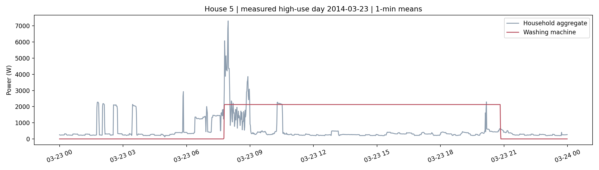
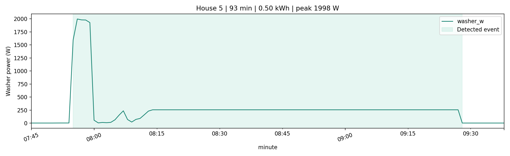
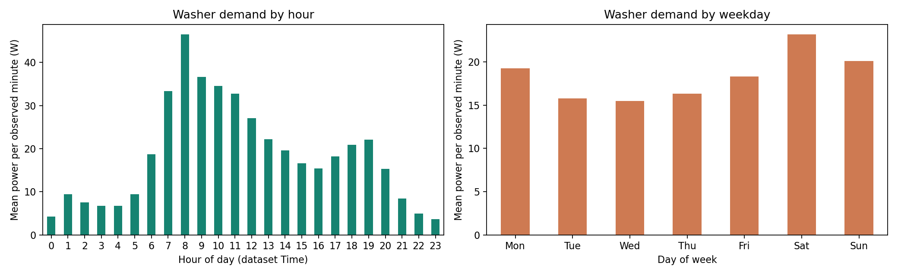
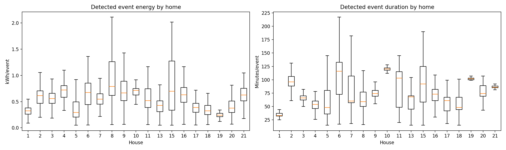
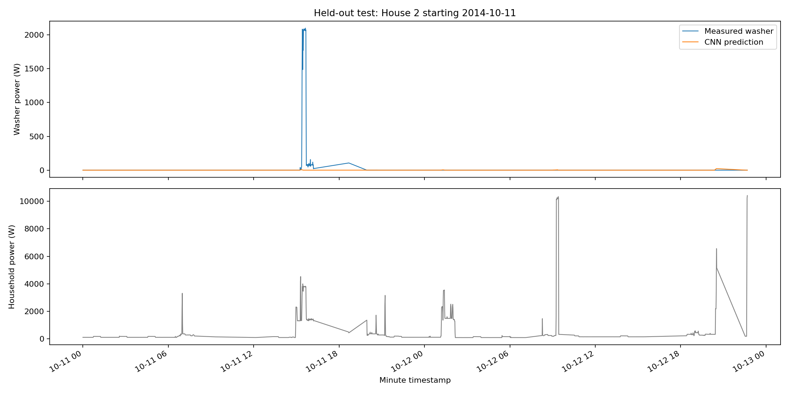
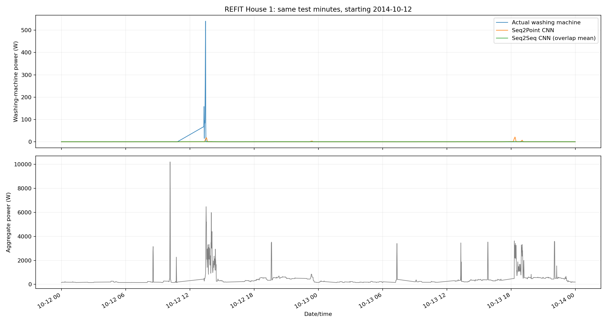
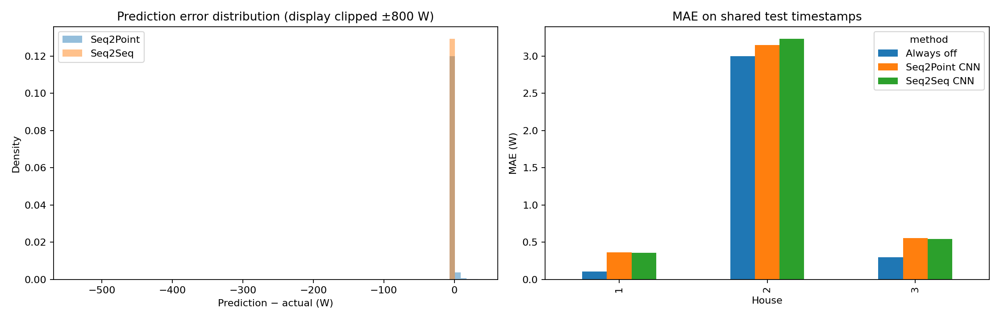
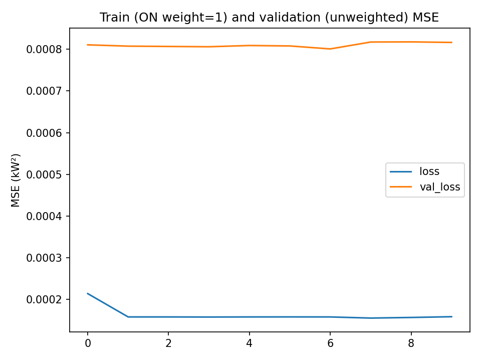
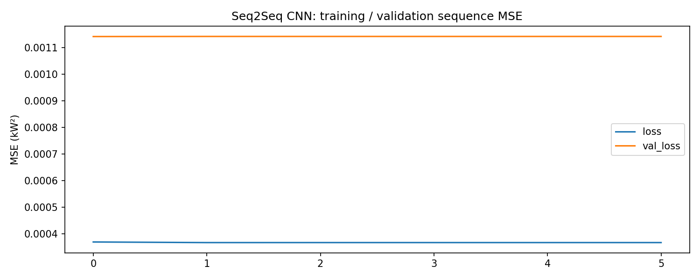
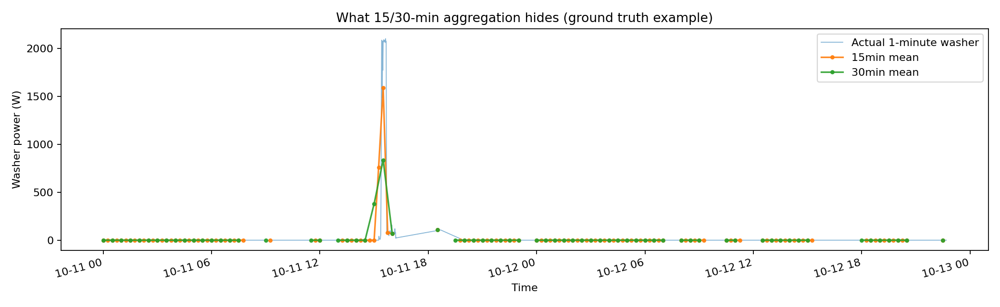

# Washing-Machine Analysis and Model Results

The directly metered EDA identifies substantial variation in washer events and morning/weekend demand. The saved disaggregation models, however, predict mostly near-zero power and miss most active minutes. Their small overall errors are driven by an evaluation set dominated by off states and heavily filtered windows.

All primary model metrics below are from [03_seq2seq_vs_seq2point_common_metrics.csv](artifacts/model_results/03_seq2seq_vs_seq2point_common_metrics.csv). Cycle statistics are calculated from [02_cycles.csv](artifacts/refit_outputs/02_cycles.csv). These reports reuse the saved experiments; training was not rerun.

## EDA scope and availability

The analysis uses official cleaned washer channels in **19 households: 1-11, 13 and 15-21**, across each home's available dates. The combined endpoints are **2013-09-17 to 2015-07-10**, with unequal coverage by household. House 4 represents two summed washer meters. Full per-home coverage is in [DATA.md](DATA.md).

Across 14,960,575 household-minute slots, paired aggregate/washer availability is **87.36%**. Missing paired minutes range from **5.84%** in House 18 to **24.62%** in House 2. Washer demand is below 20 W during approximately **96.04%** of paired observed minutes; this includes standby consumption, not just exact zeros. EDA retains issue-flagged readings, so these summaries are descriptive and require quality checks before operational use.

## Operating-event rule

An active minute has washer power **at least 20 W**. Join active segments separated by up to **15 observed off minutes**, then retain events lasting **15-240 minutes** and consuming at least **0.05 kWh**. Never bridge missing washer labels.

For one-minute mean power, event energy is `sum(washer_W) / 60,000` kWh. Events are heuristic activity periods, not verified wash-program counts: pauses can split a program, bridging can merge programs, and House 4 can contain simultaneous machine use. The rule rejects long activity periods and low-energy events by design.

The saved analysis detects **6,581 events**. Pooled event medians are **68 minutes**, **2,097.8 W peak power**, and **0.533 kWh**. The middle half spans **54-98 minutes** and **0.353-0.710 kWh**.

| House | Events | Median duration, min | Median peak, W | Median energy, kWh |
| --- | ---: | ---: | ---: | ---: |
| 1 | 372 | 33 | 2,327 | 0.322 |
| 2 | 325 | 96 | 2,090 | 0.614 |
| 3 | 639 | 66 | 1,929 | 0.557 |
| 4, two meters | 254 | 54 | 2,556 | 0.721 |
| 5 | 676 | 48 | 2,069 | 0.293 |
| 6 | 119 | 116 | 2,052 | 0.672 |
| 7 | 837 | 60 | 2,082 | 0.548 |
| 8 | 372 | 59 | 2,337 | 0.787 |
| 9 | 243 | 74 | 2,210 | 0.665 |
| 10 | 582 | 120 | 2,053 | 0.711 |
| 11 | 76 | 103 | 2,314 | 0.520 |
| 13 | 441 | 68 | 2,125 | 0.426 |
| 15 | 249 | 92 | 2,181 | 0.699 |
| 16 | 308 | 73 | 2,050 | 0.628 |
| 17 | 278 | 61 | 2,046 | 0.387 |
| 18 | 134 | 48 | 2,191 | 0.323 |
| 19 | 257 | 102 | 1,754 | 0.241 |
| 20 | 189 | 74 | 2,272 | 0.377 |
| 21 | 230 | 86 | 2,144 | 0.624 |

Median event energy ranges from **0.241 kWh** in House 19 to **0.787 kWh** in House 8. Duration and energy do not rank homes identically. Neither these medians nor raw event counts control for load size, wash program, appliance type, occupants, missingness or monitoring duration.

## EDA figures and interpretation

### 24-hour aggregate and washer trace

The saved figure shows House 5 on **2014-03-23**. It was selected as the highest observed washer-energy day among the first five retained homes, rather than a random or typical day.

The long washer plateau near 2.1 kW frequently exceeds the aggregate trace. This is inconsistent with a straightforward whole-home power balance and is a **data-quality warning**, potentially related to stale/filled values or sensor alignment. Its cause is not established. It should not be interpreted as a confirmed all-day wash or evidence of unusually high consumption. A quality-screened ordinary day should replace it as the representative example in a future run.

### Detected event

This House 5 example lasts **93 minutes**, uses approximately **0.50 kWh**, and peaks at **1,998 W**. The initial high-power stage and subsequent lower-power stages show why both duration and integrated energy matter. Heating is a plausible interpretation of the high-power stage, but program metadata would be needed to confirm it. The long flat section also deserves a raw-versus-cleaned check.

### Hourly and weekday demand

The largest observed mean demand occurs in the **08:00 hour** and on **Saturday**; demand is generally higher during the morning than late at night. These are mean W per valid paired observed minute, weighted by the number of observed minutes across homes. Missing periods are excluded rather than counted as off.

The chart measures demand, not cycle-start probability. Hours use the dataset's supplied cleaned `Time` field, without conversion to another country's timezone. Unequal household coverage and retained issue flags may affect the pooled pattern.

### Cross-household events

Energy and duration vary substantially across homes, and a longer event does not necessarily consume more energy. House 4's summed meters complicate direct single-machine comparisons. The boxplots hide outlier points; unusual events remain in the CSV and should still be audited. These differences motivate program-aware analysis, but do not prove that any household is inefficient.

## Models and rationale

Both CNNs use **only aggregate one-minute power** as model input, with a **61-minute window**. Seq2Point predicts the midpoint washer power; Seq2Seq predicts a full aligned washer window and reconstructs a timeline through overlap averaging.

The shared architecture has five convolutional layers (30/30/40/50/50 filters, 10/8/6/5/5 kernels), a 1,024-unit dense layer, and a linear output. Temporal context is useful because aggregate amplitude alone cannot distinguish competing loads.

The approach is adapted from [Zhang et al. (2018)](https://arxiv.org/abs/1612.09106), using REFIT, one-minute inputs and 61-point windows instead of claiming the paper's benchmark performance. Predictions are converted from kW to W and constrained to the range from zero to the nonnegative aggregate reading at that minute.

Training uses MSE, Adam at 0.0005, batch size 256, a maximum of 30 epochs and validation-based early stopping. Active-example weights are **1.0**, and the 120,000-window per-home cap was not reached. Thus the saved run received no effective activity rebalancing.

## Validation and leakage controls

Houses **1, 2 and 3** cover 2014-06-01 inclusive to 2014-11-01 exclusive. Each home's full minute timeline is partitioned before window extraction:

| Partition | Fraction | Inclusive first minute | Inclusive last minute |
| --- | ---: | --- | --- |
| Training | 70% | 2014-06-01 00:00 | 2014-09-16 02:23 |
| Validation | 15% | 2014-09-16 02:24 | 2014-10-09 01:11 |
| Test | 15% | 2014-10-09 01:12 | 2014-10-31 23:59 |

Input windows stay entirely within one partition, so neighboring overlapping windows do not cross train/validation/test boundaries. Aggregate normalization uses training-only values (mean **408.944 W**, standard deviation **789.310 W**). Validation loss controls early stopping; test data do not determine normalization or stopping.

Seq2Point requires valid aggregate readings and no issue flag throughout the input window, plus a valid midpoint target. Seq2Seq additionally requires all target readings in its output window. Evaluate both models and the always-off baseline on the intersection of their predicted test timestamps.

The shared evaluation contains **55,823 minutes**: House 1, **19,977**; House 2, **19,006**; House 3, **16,840**. This is **56.30%** of the 99,144 available test timeline slots across the three homes. Seq2Seq reconstructs 80,483 test minutes before the common-timestamp restriction; its standalone coverage is larger because output windows include edge positions. Scores from that broader set should not be compared directly with Seq2Point's scores. It is a test on later periods of known households, not unseen-home generalization. Overlapping windows make neighboring test errors correlated; no independent-block confidence intervals or multiple-seed comparison are reported.

## Metric definitions

- **MAE (W):** typical absolute power error. With mostly off minutes it can favor a model that predicts zero.
- **RMSE (W):** emphasizes large missed peaks and load errors.
- **Activity precision, recall and F1:** minute-level binary scores using actual/predicted power at least 20 W. They do not measure complete-cycle detection.
- **SAE:** `abs(predicted_kWh - true_kWh) / true_kWh` over evaluated minutes. It measures total-energy bias but can hide timing errors and is unstable for very small true totals.

Energy totals refer only to evaluated timestamps. They are not complete-period household energy or a billing estimate. When a score has no predicted positives, the notebook reports precision as zero.

## Saved model results

### Pooled comparison on identical timestamps

| Method | MAE, W | RMSE, W | Precision | Recall | F1 | Predicted kWh | SAE |
| --- | ---: | ---: | ---: | ---: | ---: | ---: | ---: |
| Always off | 1.150 | 44.119 | 0.000 | 0.000 | 0.000 | 0.000 | 1.000 |
| Seq2Point CNN | 1.370 | 44.075 | 0.049 | 0.044 | 0.046 | 0.219 | 0.795 |
| Seq2Seq CNN | 1.395 | 44.102 | 0.000 | 0.000 | 0.000 | 0.233 | 0.782 |

Ground-truth energy on the common timestamps is **1.070 kWh**. Seq2Point underestimates it by **79.53%** and Seq2Seq by **78.22%**. Both have worse MAE than the zero baseline. Their very small RMSE improvements do not establish useful disaggregation.

### Per-home comparison

| House | Method | MAE, W | RMSE, W | F1 | True kWh | Predicted kWh | SAE |
| --- | --- | ---: | ---: | ---: | ---: | ---: | ---: |
| 1 | Always off | 0.109 | 5.666 | 0.000 | 0.036 | 0.000 | 1.000 |
| 1 | Seq2Point | 0.362 | 5.766 | 0.000 | 0.036 | 0.086 | 1.373 |
| 1 | Seq2Seq | 0.360 | 5.665 | 0.000 | 0.036 | 0.084 | 1.310 |
| 2 | Always off | 2.998 | 75.002 | 0.000 | 0.950 | 0.000 | 1.000 |
| 2 | Seq2Point | 3.149 | 74.923 | 0.000 | 0.950 | 0.052 | 0.946 |
| 2 | Seq2Seq | 3.235 | 74.972 | 0.000 | 0.950 | 0.077 | 0.919 |
| 3 | Always off | 0.300 | 8.104 | 0.000 | 0.084 | 0.000 | 1.000 |
| 3 | Seq2Point | 0.557 | 8.046 | 0.109 | 0.084 | 0.081 | 0.034 |
| 3 | Seq2Seq | 0.545 | 8.103 | 0.000 | 0.084 | 0.072 | 0.141 |

House 3's Seq2Point SAE looks favorable because its small predicted total happens to be close to the measured total. Activity F1 remains only 0.109, so that total-energy agreement does not demonstrate correct timing or cycle recovery.

## Failure analysis

### Filtering removes most informative examples

An additional audit of the supplied cleaned CSVs and current window-selection functions found:

| Split | Eligible midpoint count | Active eligible midpoints | Active share |
| --- | ---: | ---: | ---: |
| Training | 260,596 | 234 | 0.090% |
| Validation | 55,953 | 184 | 0.329% |
| Common test | 55,823 | 114 | 0.204% |

Before issue/window filtering, there are **18,684** active paired training minutes and **3,714** active paired test minutes. Only **1.25%** and **3.07%**, respectively, survive as eligible midpoints. House 2 has no active eligible validation midpoints. See [03_window_selection_audit.csv](artifacts/model_results/03_window_selection_audit.csv) and [03_seq2seq_coverage.csv](artifacts/model_results/03_seq2seq_coverage.csv).

Across all paired test minutes before issue/window filtering, recorded washer energy is approximately **27.375 kWh**. The common evaluation retains only **1.070 kWh (3.91%)**. The broader total still contains potentially questionable labels, but this contrast demonstrates that the selected test set omits most observed activity. It cannot represent full-period washer recovery.

### Predictions collapse toward the off state

Recalculation from [common predictions](artifacts/model_results/03_seq2seq_vs_seq2point_common_predictions.csv) gives:

| Method | True-positive minutes | False-positive minutes | Missed active minutes | Active-only MAE, W |
| --- | ---: | ---: | ---: | ---: |
| Seq2Point | 5 | 97 | 109 | 554.61 |
| Seq2Seq | 0 | 0 | 114 | 557.54 |

The remaining **55,709** common test minutes are below the active threshold. Seq2Point's maximum predicted power on this set is only **34.57 W**, and Seq2Seq's is **4.01 W**, far below typical measured event peaks.

Sparse active training examples, unweighted MSE, short context and label-quality restrictions are plausible contributors to this behavior. They are not isolated causal explanations: no controlled ablation was run.

### Actual versus predicted traces

The saved House 2 trace begins **2014-10-11** and shows a measured peak above 2 kW that Seq2Point largely misses. The figure shows evaluated timestamps only. Lines join separated valid points, so ramps across missing intervals should not be read as continuous measured behavior.

The current notebook's plotting cell selects the first prediction home, whereas this saved figure uses House 2. The image should be treated as a saved experiment snapshot; rerunning the current cell can select a different example.

The common-timestamp House 1 example, starting **2014-10-12**, similarly shows both CNNs remaining near zero when measured washer demand rises. Other aggregate peaks need not be washer usage: simultaneous appliances and unmetered loads make amplitude alone ambiguous.

The error histogram concentrates around zero because off minutes dominate. The per-home bars show that the always-off baseline has lower MAE in every home. The displayed error histogram covers the selected plot home and clips errors for visualization; it does not replace pooled or active-state scores.

### Learning curves

Training and validation losses plateau, and validation loss stays above training loss. The saved curves show ten Seq2Point epochs and six Seq2Seq epochs, fewer than the maximum of 30 because of early stopping. Low loss on predominantly off examples is not evidence of successful event detection.

## Missing labels, appliance changes and competing loads

Requiring fully valid windows leaves gaps in predictions and preferentially removes some operating periods. Official filling/zero replacement can also make stale labels appear valid. Appliance replacement or moved meters can change signatures or the meaning of a channel; no systematic change-point audit was performed. Other appliances contribute to the aggregate, including unmetered loads, and heating signatures can overlap.

Issue flags rely on appliance metering information that would generally be unavailable in an aggregate-only utility deployment. Future deployment therefore needs a quality policy based on available meter information and a separately audited ground-truth evaluation set.

## Impact of 15- or 30-minute readings

The figure averages a **ground-truth example** from evaluated timestamps; it does not evaluate a model trained at coarser resolution. Short heating peaks are flattened and event boundaries become less precise. Multiple appliance activities within one interval become harder to separate.

For complete observations, duration-weighted means preserve integrated energy while losing timing information. Here the selected timestamps can be incomplete, so coarse means require observation-count checks and should not be interpreted as full-bin energy. A deployment comparison must resample both inputs and targets, retrain at each resolution, choose context in physical time, and evaluate on common covered periods.

## Practical interpretation and next experiment

The metered EDA supports investigating washer-program energy and usage timing, subject to label checks. The current models do not support appliance billing, precise customer advice or reliable automated cycle detection.

First audit the active cycles lost to flags and missing inputs; retain missingness and reject labels on a justified basis. Then test activity-aware sampling/weighting and longer context against a simple baseline. Use cycle-level and active-minute metrics, hold out entire households, and validate again on locally collected data before assessing utility value. The proposed savings pilot is in [Recommendation.md](Recommendation.md).
